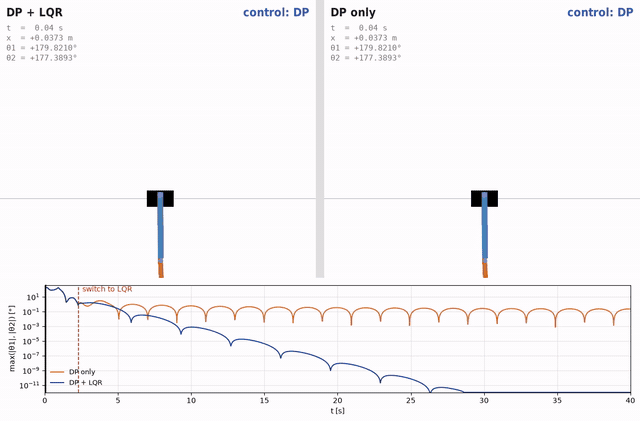
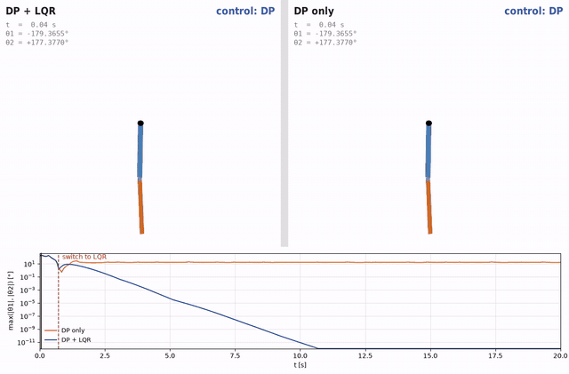

# Code for "The Limit of Grid-Based Dynamic Programming Near an Unstable Equilibrium"

This repository has the code that reproduces the double pendulum experiment of Section 5.1
(Table 1, Table 2 and Figure 1) and two videos. It does not include the code of the double
pendulum on a cart (Section 5.2) or the closed-loop runs with the rounded LQR gain.

## Videos

Each video shows one episode twice, side by side, from the same initial state with both pendulums
hanging down: on the right with the dynamic programming policy alone, on the left switching to an
LQR near the upright equilibrium. The plot below shows the largest angle to the vertical, in
degrees, on a logarithmic scale. With dynamic programming alone the pendulums stay near the
vertical but do not converge to it. After the switch to the LQR the state converges.

**Double pendulum on a cart.** The policy of Section 5.2 (25 points per axis, 41 actions), 40 s.
Full video: [`videos/double_cartpole.mp4`](videos/double_cartpole.mp4).

**Double pendulum.** A swing-up policy with 61 points per axis and 41 actions, 20 s. This is not
one of the grids of Tables 1 and 2, which are computed on a small box around the equilibrium.
Full video: [`videos/double_pendulum.mp4`](videos/double_pendulum.mp4).

## Contents

| Path | What it is |
|---|---|
| `src/cuda_policy_iteration.py` | Policy iteration on a grid with barycentric interpolation, on the GPU |
| `experiments/resolution/nonlin_sweep.py` | The refinement sweep: solves each grid, reads the axis gain, simulates the closed loop |
| `experiments/resolution/stabilization_sweep.py`, `selfsim.py` | The double pendulum model, its linearization and the discounted LQR |
| `results/nonlin.jsonl` | The log of the runs reported in the paper, one grid per line |
| `make_tables.py` | Prints Table 1, Table 2 and the data of Figure 1 from a log |
| `videos/` | The two videos above, and `videos/preview/` with the animated previews shown in this page |

## The tables from the saved log (no GPU)

    python make_tables.py

This needs only Python 3. Add `--lqr` for the LQR columns of Table 1 (needs the requirements below).

## Running the sweep (GPU)

Requirements: an NVIDIA GPU, Python 3.10 or later, and

    pip install -r requirements.txt

(choose the `cupy` wheel that matches your CUDA version).

A short check, grids with M = 5, ..., 15 for q = 0.2 and box 0.4 (about a minute and a half on an RTX 3090):

    python experiments/resolution/nonlin_sweep.py --systems dpend --R 0.4 --q 0.2 \
        --bins 11 13 15 17 19 21 23 25 27 29 31 --out-dir out > my_runs.jsonl
    python make_tables.py my_runs.jsonl

`--bins` is the number of grid points per axis, 2M + 1. The gains and spectral radii should match
the first rows of Table 2, and the amplitudes the first points of Figure 1.

The runs of the paper use M = 5, ..., 20 and then 25, 30, ..., 55, for q in {0.2, 0.3, 0.5} and
boxes 0.4 and 0.8. The intermediate values of M were not computed, except M = 21, ..., 29 for
q = 0.5 and box 0.8 (add `--bins 43 45 47 49 53 55 57 59` for that case):

    python experiments/resolution/nonlin_sweep.py --systems dpend --R 0.4 0.8 --q 0.2 0.3 0.5 \
        --bins 11 13 15 17 19 21 23 25 27 29 31 33 35 37 39 41 51 61 71 81 91 101 111 \
        --out-dir out > my_runs.jsonl

The largest grid (M = 55, 111 points per axis, 1.5e8 states) takes about 13 minutes and the whole
command a few hours. Grids already saved in `--out-dir` are skipped, so the command can be resumed.
The action table of each grid is saved there as a compressed `.npz` (up to about 50 MB each).

## What each line of the log contains

`system`, `R` (the box size, called ell in the paper), `q`, `M`, `delta` (the cell side in the angle
coordinates), `K_hat_over_kappa` (the axis gain in multiples of kappa), `rho_lin_Khat`
(the spectral radius of A + B K), `symmetric_axes` and `pi0` (the hypotheses of Theorem 1 on the
policy), `near` and `far` (closed-loop statistics from 512 initial states within 3 and 8 cells of the
origin; `amp_med` is the median amplitude in cells over the last quarter of 4000 steps), and the
smallest gap between the best and the second-best action near the origin.

The solver works in single precision.
